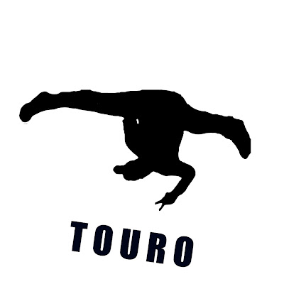

<p align="center">
  <a href="https://www.youtube.com/@Tourocapoeira"></a>
</p>

<h1 align="center">touro-shorts</h1>

<p align="center">
  <b>Text that moves like capoeira.</b><br>
  Words land on the peak of a movement, and a kick can knock them off screen.
</p>

<p align="center">
  
  
  
  
</p>

<p align="center">
  <a href="https://www.youtube.com/@Tourocapoeira">TOURO on YouTube</a> ·
  <a href="https://sc-capoeira.de/">Simplesmente Capoeira</a> ·
  <a href="STYLE.md">Style spec</a>
</p>

---

Animated, brand-styled text for [Simplesmente Capoeira](https://sc-capoeira.de/) Instagram
shorts (12–20 s, 1080×1920). One Python file, one JSON file per edit. The design rules live in
[STYLE.md](STYLE.md).

## Setup

Needs [uv](https://docs.astral.sh/uv/) and `ffmpeg` on PATH (`brew install uv ffmpeg`).

```bash
uv sync
export SC_CONTENT="/path/to/sc-content"   # root folder of the raw clips
```

## Make a short

```bash
uv run shorts.py peaks "$SC_CONTENT/movimento/<clip>.mov"   # when the strongest moves happen
cp edits/261117-touro.json edits/<date>-<name>.json            # then edit text + timings
uv run shorts.py render edits/<date>-<name>.json               # -> out/<name>.mp4
uv run test_shorts.py                                          # checks every edit against STYLE.md
```

An edit file:

```json
{
  "input": "$SC_CONTENT/movimento/261117-ksg-movimento/touro-sequence-edit.mov",
  "output": "out/261117-touro.mp4",
  "cards": [
    {"text": "It is not about talent", "in": 0.6, "hit": 1.25, "out": 3.4},
    {"text": "It is about practice", "in": 17.6, "hit": 18.25, "out": 19.6, "kick": "left"}
  ]
}
```

- The last word of each card is its key word: set huge, with the yellow marker.
- `in`: the card starts appearing. `hit`: the key word has landed. `out`: the card starts leaving.
- `kick` (optional, `left`/`right`): at `out`, a kick knocks the letters away in that direction.

## Working with Claude Code

This repo has project skills in `.claude/skills/`:

- `capoeira-shorts`: the end-to-end workflow and design taste for a new edit.
- `coding-principles`: how code in this repo is written (simple, deep modules, verified).

## Fonts

`fonts/` holds Archivo (from sc-capoeira.de), licensed under the SIL Open Font License 1.1.
See [fonts/OFL.txt](fonts/OFL.txt).

The TOURO logo (`docs/touro-logo.jpg`) belongs to [TOURO](https://www.youtube.com/@Tourocapoeira)
and isn't covered by the code in this repository.
